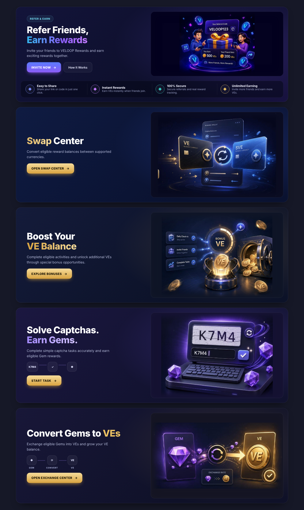

# VELOOP Rewards – Banner Redesign (Task 08)

## Project Overview
A redesign of five promotional / feature banners for **VELOOP Rewards**, built as reusable React components on the `#161827` app background. Each banner has its own illustration, animation and CTA while sharing one `RewardBanner` shell.

## Banner List
| Banner | Route | Visual |
|---|---|---|
| Refer & Earn | `/refer` (`/how-it-works`) | Two friends, gift box, VE coins, referral code card + 4-point feature strip |
| Swap Center | `/swap` | VE and SVE reward cards with swap icon over a reward wallet |
| Bonus VEs | `/bonus` | Glowing BONUS VE coin, open vault, activity chips |
| Captcha Tasks | `/captcha` | Laptop with captcha K7M4, gems, task → verify → reward flow |
| Exchange Center | `/exchange` | GEM card converting to a VE card, Gem → Convert → VE flow |

## Features
- 100% width, heights clamped per device (Desktop 410–450px, Tablet 380–540px, Mobile 330–520px)
- Premium fintech look: deep navy surfaces, gold / purple accents, Manrope typography, feathered artwork (optimised JPGs in `src/assets`) with subtle floating animation
- Whole card is clickable; CTA has hover, active and keyboard focus states
- Whole banner card is clickable; secondary CTA on Refer & Earn
- `prefers-reduced-motion` respected; aria labels and alt text on all visuals
- Reward numbers are **dummy data** – replace with approved values before release

## Technology Stack
React 18, Vite, Bootstrap 5, CSS Modules, React Hooks (useState, useId, useNavigate), React Router, Lucide React, React Icons

## Installation
```bash
npm install
npm run dev        # http://localhost:5173
```

## Development Commands
| Command | Purpose |
|---|---|
| `npm run dev` | Start dev server |
| `npm run build` | Production build into `dist/` |
| `npm run preview` | Preview the production build |

## Folder Structure
```
src/
├── components/
│   ├── RewardBanner/          reusable shell (layout, sizing, CTA, themes, footer slot)
│   ├── ReferEarnBanner/
│   ├── SwapCenterBanner/
│   ├── BonusVEsBanner/
│   ├── CaptchaTasksBanner/
│   ├── ExchangeCenterBanner/
├── pages/                     Home, Placeholder routes
├── styles/global.css          reset + reduced-motion
├── assets/  utils/
```

## Responsive Design
- **Desktop (≥1024px):** two columns, height `clamp(410px, 34vw, 450px)`
- **Tablet (768–1023px):** two columns, height follows content within 380–540px
- **Mobile (<768px):** illustration on top, then text and CTA; height auto within 330–520px

## Animation Details
Floating illustration (6s loop), entrance fade, hover lift + border glow + artwork zoom, CTA sheen and arrow nudge. All animations are disabled under `prefers-reduced-motion`.

## Screenshots
| Desktop (1440px) | Tablet (820px) | Mobile (390px) |
|---|---|---|
|  |  |  |

## Live Demo
https://veloopbanner-self.vercel.app/
## GitHub Repository
https://github.com/anandnare/veloopbanner/

## Author
Anand Basavraj Nare

## Deployment
`vercel.json` and `public/_redirects` are included so client-side routes work on Vercel and Netlify.
